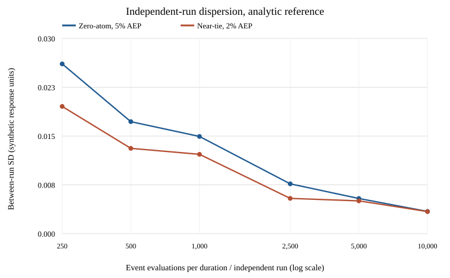
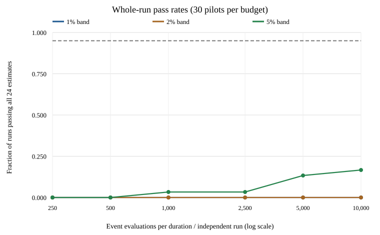

# Monte Carlo simulation-budget research — analytical phase (#148)

**Study date:** 15 November 2026. **Status:** independently reproducible synthetic *research evidence*, not a RORBwin profile, calibrated catchment result, engineering tolerance, Monte Carlo product acceptance or universal simulation-count recommendation. The #145 statistical policy, #146 sampler, #147 weighted curve, #149 common-runner adapter and #150 independent qualification remain separately owned.

## Estimand, controls and exact reference

The study estimates a weighted peak-response quantile at each of four target **response exceedance probabilities** (20%, 10%, 5% and 2%), for each of two hypothetical physical output sites (`zero_atom`, `near_tie`) and two independent storm durations (`short`, `long`). For each site/AEP it then forms the *duration envelope*, the maximum of the two duration-specific quantiles. **A full reported result has 24 estimates**: `2 sites × 4 AEPs × (2 durations + envelope)`. A conditional spread at a single fixed rainfall AEP is not being presented as a flood-frequency curve. No rainfall-frequency transformation or actual flow units are assumed in this synthetic population.

The independent synthetic inputs are `U,V ~ Uniform(0,1)` and a finite temporal-pattern state `T ~ Bernoulli(0.25)`, with one random event shared across both sites within a duration. The response is

`Q(s,d) = max(0, a(s,d)·U + b(s,d) + c(s,d)·T − L(s,d)·V)`.

The numerical values are declared in `RESPONSES` in the study script. Some outputs have a large mass at `Q=0`, while the two durations for `near_tie` compete closely. Synthetic values are dimensionless, not `m³/s`. Because the response is nonnegative and `V` is uniform, for any `q ≥ 0`, conditional survival is exactly `clamp((a·U+b+c·T−q)/L,0,1)`. The script **integrates this analytically over U and sums both TP states** (the piecewise primitive is `0`, `x²/2`, or `x−1/2`), then inverts with bisection. This makes the reference independent of MC run length; the residual bisection error is negligible at reported precision. There is no higher-count-reference uncertainty in these cases. A *real catchment* will require separate independent higher-precision runs and explicit reference uncertainty.

The study partitions the complete probability interval `U∈[0,1]` using 50 bins with interior boundaries equally spaced in a **standard-normal probability coordinate** `z∈[−3.5,3.5]`; the outer bins extend to 0 and 1. Within each bin, U is drawn **uniformly in its probability mass**, and an event carries `w_h/n_h`; stratum masses are unequal. This does **not** make rainfall Normal: the synthetic `U` variable remains uniform. The boundary method is a study setting, not a declaration of the RORBwin distribution or the as-yet-reviewed policy in #145. All zero peaks retain their weights; no events fail in the main controls. The estimator is an explicit weighted nearest-rank inverse-CDF research implementation, *not a second product estimator* owned by #147.

## Prespecified study decisions and evidence thresholds

Pilot: 50 bins × `5, 10, 20, 50, 100, 200` conditional samples, **250, 500, 1,000, 2,500, 5,000, 10,000 event evaluations per duration**, with 30 independent seed replications at each setting. Confirmation was prespecified for 1,000 and 2,500 with **100 fresh replications**, not selected by stopping at the first favourable result. Both sites share an event within a duration; durations have different seeded event populations. Separate 30-replication controls examine 25/50/100 bins at exactly 1,000 evaluations/duration, randomly sampled versus exactly enumerated finite TP at equal event cost, and weighted rank versus a defined piecewise-linear interpolation on identical draws. Every method is explicitly identified; the alternatives do **not** silently change the compatibility profile.

Provisional relative error bands are **1%, 2%, 5%**, combined with an absolute **0.002 synthetic-unit** tolerance to avoid meaningless relative errors at zero. Each of the 24 estimates must pass `|estimate−exact| ≤ max(0.002, band×|exact|)` for a *whole run* to pass. Provisional study reliability criterion: at least **95%** of independent complete runs must pass, supported by a **one-sided 95% Clopper–Pearson lower confidence bound** for the true pass probability. A budget is inadequate if its one-sided 95% **upper** bound is below 95%; otherwise it is unresolved absent a sufficient lower bound. This is a **project research criterion**, not an ARR standard. Independent run SD and CV describe expected one-run dispersion; bootstrap SD intervals resample entire independent replications, never individual stratified events. SD divided by √replications is **not** used to characterise a production run.

Runs are seeded by `SHA256(policy|root|stage|rep|duration|strata|n|TP-method|bin)` into Python `random.Random` (MT19937), with root seed `1482026`. Stage identity separates pilot and confirmation. The manifest records generator/script SHA-256, Python/platform, model parameters, bin policy, methods, event count, elapsed study time, traced peak Python memory and completeness. The RNG, distribution and numerical behaviour are *not* asserted equivalent to RORBwin for the same integer seed.

## Results: exact-reference precision and whole-run reliability

All entries below are **number of whole 24-estimate runs passing / independent replications**. Confidence intervals are exact one-sided binomial intervals. No event failures or missing probability mass occurred in these baseline experiments.

| Evaluation budget per duration | Pilot at 1% | Pilot at 2% | Pilot at 5% | Confirmation at 5% | 95% upper bound on confirmed 5% pass probability |
| ---: | ---: | ---: | ---: | ---: | ---: |
| 250 | 0/30 | 0/30 | 0/30 | — | — |
| 500 | 0/30 | 0/30 | 0/30 | — | — |
| **1,000** | **0/30** | **0/30** | **1/30** | **2/100** | **0.062** |
| 2,500 | 0/30 | 0/30 | 1/30 | 5/100 | 0.102 |
| 5,000 | 0/30 | 0/30 | 4/30 | — | — |
| 10,000 | 0/30 | 0/30 | 5/30 | — | — |

Under this *declared synthetic model and stringent whole-result criterion*, **1,000 and 2,500 are inadequate**, including at the loosest provisional 5% band: the independent confirmation's 95% upper bounds are far below the required 0.95 pass probability. The other pilot budgets also show negative screening results, but have not received independent confirmation. Neither 10,000 nor any other count is a general hydrological threshold. Even 30/30 pilot successes would only produce a one-sided 95% lower limit near **0.905**, insufficient for a claimed 0.95 pass probability.

The `near_tie` site's **2% envelope** at 1,000 evaluations/duration has pilot single-run SD **0.01231** and bootstrap 95% interval **[0.00761, 0.01654]** in synthetic response units; the exact envelope is approximately **0.84021**. The pilot selected `long` as critical in **17/30** independent runs; confirmation selected `long` in **51/100**. These proportions reflect a deliberately close competing-duration response, not an estimated random duration or a native representative-event choice. At 10,000 events/duration, the pilot SD for this output decreased to **0.00342**, but critical duration still switched (16/30 selected `long`). A stable envelope magnitude does not imply stable critical-duration identity.





The figure at 0.95 shows the **proposed reliability target**; plotted fractions are observed pass rates, not confidence bounds. See per-budget exact confidence limits in the retained summaries. Error against exact analytical truth, run-to-run mean bias, SD, CV, max and 90th-percentile absolute error, bootstrap uncertainty, critical-duration frequencies and their binomial intervals are preserved for every site/AEP/duration/envelope.

## Positive control: a declared population where 1,000 passes

A separate **constructed, nondegenerate low-variability synthetic population** (`STABLE_RESPONSES`) uses the same independent U/V/TP law, normal-coordinate probability bins with p-uniform conditional draws, two sites, two durations, four target response exceedance probabilities and 24-output whole-result rule. All response slopes, initial-loss widths and temporal-pattern effects are nonzero. This population was selected **after exploratory screening** to provide a contrast; it is *not* a blinded or random sample of hydrological catchments. The subsequent fixed-budget confirmation used **100 fresh, independently stage-separated seeds at each of 250, 500 and 1,000 evaluations per duration**, without sequential stopping. All 7,200 output rows, source/seed/probability parameters, exact analytical references, and binomial intervals are preserved in [stable_confirmation](issue148/stable_confirmation/manifest.json).

| Events per duration | Independent whole-run passes (1% band, 100 seeds) | 95% one-sided success lower | 95% one-sided success upper | Decision versus provisional 95% reliability |
| ---: | ---: | ---: | ---: | --- |
| 250 | 72/100 | 0.637 | 0.793 | **Inadequate** |
| 500 | 96/100 | 0.911 | 0.986 | **Unresolved** |
| **1,000** | **100/100** | **0.970** | 1.000 | **Adequate only for this declared synthetic population/1% band** |

At the more permissive 2% and 5% bands, all three budgets achieved 100/100 whole-result passes in this particular population; that does not imply a universally sufficient count or a generally adopted tolerance. The 100/100 observed success rate is not a 100% true success probability: its one-sided exact 95% lower confidence bound is 0.970. The second site's 10% envelope still chose different critical durations in 54 versus 46 of 100 runs at the 500-event budget, so *magnitude reliability is not critical-duration identity reliability*. These findings coexist with the negative population's poor performance even at 2,500 evaluations under 5%, demonstrating that **no universal 1,000-event minimum follows**.

The new stage used **350,000** synthetic response evaluations in **7.309 seconds** on Linux/Python 3.13.5 (peak traced memory 4.11 MiB). Together with the prior five stages' 2,275,000 evaluations, the retained analytical work includes **2,625,000 synthetic evaluations across six stages**; none is a `python-cmd` routing benchmark. The new manifest pins the actual simulation-time script SHA-256 `7f46c621229c19b9ed3efdd68be04a853941d8fe40139d42ee490007949d035f`, rather than silently attributing that execution to later formatting/type-only commits.

**Independent verification:** F/#150 independently re-evaluated all 7,200 raw values as 300 complete 24-output replications, recalculated the three 1% whole-run pass rates and exact one-sided Clopper–Pearson bounds, and independently checked all 16 positive reference quantiles by a separate 10,000-panel Simpson integration (maximum survival residual `2.46e-9`). No numerical/statistical discrepancy was found. [See the current-head scientific PR review](https://github.com/Chain-Frost/python-runoff-routing/pull/168). This review is of retained synthetic evidence, not independent execution of the Monte Carlo generator or a real catchment.

## Sensitivities and negative results

- **Bin count:** at equal 1,000 events/duration, 25/50/100 stratification levels gave near-tie 2% envelope SDs of **0.00987 / 0.00883 / 0.00979** (30 independent runs each). The observed differences are not evidence of a systematic resolution bias. Correct conditional sampling has the **same exactly integrated target** at all bin counts; different bin allocation may change sampling variance. Rainfall IFD interpolation and deterministic solver timestep errors are entirely separate, unstudied here.
- **Omitted upper-probability endpoint:** if the upper **2% probability mass** is unknown rather than sampled, the near-tie `long` 5% target has a conservative quantile range **[0.73464, 0.78472]** around its exact **0.75804**. The corresponding 2% target has **no qualified finite upper bound** without an external response-support limit. Renormalising the 98% modelled mass would disguise this problem. These are theoretical missing-tail bounds, not a completed run.
- **Finite TP variance reduction:** at equal 1,000-event cost/duration, exact paired evaluation of the two discrete TP states had **2/30** whole-run passes at the 5% band, compared with **1/30** for random TP selection. This is insufficient evidence of improved precision; the paired scheme halves the number of distinct U/V inputs and does not enlarge the finite TP evidence population. No new production policy is adopted.
- **Interpolation:** weighted nearest rank and experimental linear interpolation applied to the *same draws* both had **1/30** whole-run 5%-band passes at 1,000 events/duration. The study does not validate a general interpolation or tie policy; #147 owns the eventual implemented inversion rule.
- **Failures/coverage:** all retained synthetic runs use total stratum mass 1.0, with zero failed or unmodelled event mass. Focused tests reject a positive-weight missing sample and include zero-flow atom and ties; a real routing nonconvergence or unresolved IFD tail must cause an explicitly incomplete result, not a renormalised estimate.

## Run cost, replay and interpretation

The harness first completed a **77,000-evaluation timing pilot in approximately 1.1 seconds**. Explicit stage caps prevented unbounded campaigns. On this Linux/Python 3.13.5 study environment, the final five stages made **2,275,000 synthetic response evaluations** in about **32 seconds** total across the analytical generator, quantile inversion, exact-reference evaluation, confidence statistics and in-process memory tracing. Individual stage counts: pilot 1,155,000; confirmation 700,000; bins 180,000; finite TP 120,000; interpolation 120,000. Per-stage manifests retain actual times and peak traced memory. These costs are **not** `python-cmd` event-routing benchmarks; routing time, memory, source preparation and failure rates remain unmeasured. The previously completed 1,000-event performance requirement is not reopened. The additional positive confirmation and six-stage combined cost are reported in the section above.

Use Python ≥3.13; no product dependencies or hosted workflows are added. The scripts use only the standard library, except `pytest` for the nine focused controls:

```sh
python -m pytest -q tests/test_mc_convergence_research.py
python repo-scripts/mc_convergence_research.py --stage smoke --output .local/mc-smoke
python repo-scripts/mc_convergence_research.py --stage pilot --opt-in --output .local/mc-pilot --max-evaluations 1155000 --max-wall-seconds 90
python repo-scripts/mc_convergence_research.py --stage confirmation --opt-in --output .local/mc-confirm --max-evaluations 700000 --max-wall-seconds 90
python repo-scripts/mc_convergence_research.py --stage bins --opt-in --output .local/mc-bins --max-evaluations 180000 --max-wall-seconds 90
python repo-scripts/mc_convergence_research.py --stage tp --opt-in --output .local/mc-tp --max-evaluations 120000 --max-wall-seconds 90
python repo-scripts/mc_convergence_research.py --stage interpolation --opt-in --output .local/mc-interp --max-evaluations 120000 --max-wall-seconds 90
python repo-scripts/mc_convergence_research.py --stage stable-independent-confirmation --opt-in --output .local/mc-stable --max-evaluations 350000 --max-wall-seconds 90
python repo-scripts/plot_mc_convergence.py .local/mc-pilot/summary.json --output .local/mc-plots
```

Each output directory must be new; outputs contain `manifest.json`, `raw.csv` (all 24 quantiles per replication), `summary.json` and `endpoint_sensitivity.json`. The included retained original results, positive-control receipts and two SVG figures can be regenerated without routing, native RORB files, an installed CLI or external network. Independent reviewers should audit the exact integral and quantile inversion, one-sided binomial bounds, whole-output pass definition, seed independence, bootstrapping at the **replication** level, and absence of sequential optional stopping. Both synthetic retained populations have now received independent F/#150 output/reference reviews with no reported statistical discrepancies. They remain author-run generator evidence, not independent generator re-execution or real-model/native engineering sign-off.

## Subsequent catchment qualification — blocked by explicit interfaces, not the MVP

Scope D should consume the **adopted A/B/C/E policy and event ledger**, not invent a second sampler/runner/result model. Use a small named, qualified `python-cmd/cmd-6.44` fixture population, with pinned rainfall/loss sources, physical sites, supported AEP range, output-site identity, method and engine revision. Preflight **time/event cap** and source/engine completeness before a costly run. Compare to a larger **independent-seed** reference (with reference CI and bin/tail sensitivity); a high-count simulated curve is not truth. Retain every failed/zero/partial outcome, identify any deterministic-engine bias separately, and rerun prespecified confirmation at candidate budgets. No RORBwin stochastic/native or engineering acceptance follows from this synthetic study.

## Sources

1. *Australian Rainfall and Runoff*, [Book 4 v4.2, §4.3.3.3](https://www.arr-software.org/pdfs/ARR_190514_Book4_V4.2.pdf) — indicative stratification/simulation guidance, not a universal minimum or RORBwin executable specification.
2. Nathan & Weinmann (2013), [ARR Monte Carlo discussion paper, §§3–5 and 7](https://arr.ga.gov.au/__data/assets/pdf_file/0017/40562/ARR_DiscussionPaper_MonteCarlo.pdf) — stratified rainfall probability and conceptual frequency estimation.
3. Dong & Nakayama (2020), [*A Tutorial on Quantile Estimation via Monte Carlo*, §§4–6](https://web.njit.edu/~marvin/papers/qtut-r2.pdf) — quantile inversion, Monte Carlo error, variance reduction and appropriate uncertainty methods.
4. Clopper & Pearson (1934), [*The Use of Confidence or Fiducial Limits Illustrated in the Case of the Binomial*](https://doi.org/10.1093/biomet/26.4.404) — exact binomial confidence limits for independent whole-run success/failure outcomes.

Related: [parent #9](https://github.com/Chain-Frost/python-runoff-routing/issues/9); [policy #145](https://github.com/Chain-Frost/python-runoff-routing/issues/145); [sampling #146](https://github.com/Chain-Frost/python-runoff-routing/issues/146); [aggregation #147](https://github.com/Chain-Frost/python-runoff-routing/issues/147); [execution #149](https://github.com/Chain-Frost/python-runoff-routing/issues/149); [qualification #150](https://github.com/Chain-Frost/python-runoff-routing/issues/150).


## Large-replication numerical correction (16 November 2026)

The original research used a valid Clopper–Pearson inversion but an unstable binomial-tail summation
that began at \`p**n\` or \`(1-p)**n\`. At sufficiently large numbers of independent replications,
those powers underflowed even near the distribution's mode, causing false tail probabilities
and incorrect confidence limits. The corrected standard-library algorithm evaluates the starting
probability in log space (\`math.lgamma\`, \`math.log1p\`) and sums outwards from the relevant
tail boundary towards lower-probability masses. Exact all-success and no-success endpoints
use direct stable formulas (\`exp(log(alpha)/n)\` and \`-expm1(log(alpha)/n)\`).

Focused checks include one million independent Bernoulli trials with success fractions
0.50, 0.95, 0, 1 and rare events. For 500,000 successes / 1,000,000 trials, one-sided 95%
Clopper–Pearson bounds are approximately 0.49917707395 and 0.50082292605,
cross-checked with an independent SciPy beta-quantile calculation **locally for research
verification only**. No SciPy or other scientific dependency is added to the product.

The prior 30/100-replication archived raw results, study decisions and reported limits
remain attributable to their original execution revisions and are **not regenerated** by
this correction. This is a confidence-limit *numerics* repair, not a new hydrological study.

**Actual catchment status:** #146 and #147 are staged, but the #149 B→E→C execution adapter
remains a separately reviewed PR. A qualified real-catchment study cannot be claimed from
the existing synthetic controls or a draft E adapter. Its preflight must identify a
named authorised original-source catchment, qualified \`python-cmd/cmd-6.44\` profile,
physical site IDs, adopted supported IFD/TP/loss inputs and nonzero tail coverage,
and must first pass a small B→E→C replay and completeness check before expensive
independent-seed reference and confirmation runs. Do not run unbounded work in CI.


### Optional SciPy precision backend at very large replication counts

Install `python -m pip install ".[research]"` to use SciPy's regularized incomplete
beta function `scipy.special.betainc` at n >= 1,000,000. The normal product
installation remains dependency-free. For n=1,000,000,000, k=500,000,000,
and p=0.5, SciPy returns 0.5000126156626065; the standard-library log-PMF
recurrence returns 0.5000127075130283 (difference about 9.2e-8).
Without the optional extra, the existing logarithmic recurrence remains
available, and its million-trial cases are tested. Document whether SciPy
was installed when reporting confidence results for very large n.

Historical 30- and 100-replication receipts are unchanged because their
replication counts are below the optional path's threshold.

### Catchment qualification status, 16 November 2026

Sampler #146, frequency #147 and execution #149 are now integrated into
draft staging #151, which removes the previous software-integration blocker.
However the bundled `examples/arr-design-synthetic-ifd.csv` has only 1%
and 2% rainfall AEP anchors and is expressly synthetic. No qualified
site-specific BoM/ARR IFD, temporal-pattern, loss and catchment population
has been admitted for this study. The adopted nonextrapolated ARF law
supports 1%-50% AEP, leaving 51% of rainfall probability mass unknown.
A completed software-ledger run over this support cannot be promoted to
a qualified *full-domain* flood-frequency estimate.

Actual catchment acceptance requires one named permitted source model and
physical output site, matched input/routing evidence, a cost-capped pilot,
a separately estimated high-precision reference with uncertainty, and
prespecified independent-seed confirmation with explicit missing/failed
mass. No actual catchment convergence verdict or native RORBwin parity
is claimed by this research-only confidence-limit repair.
